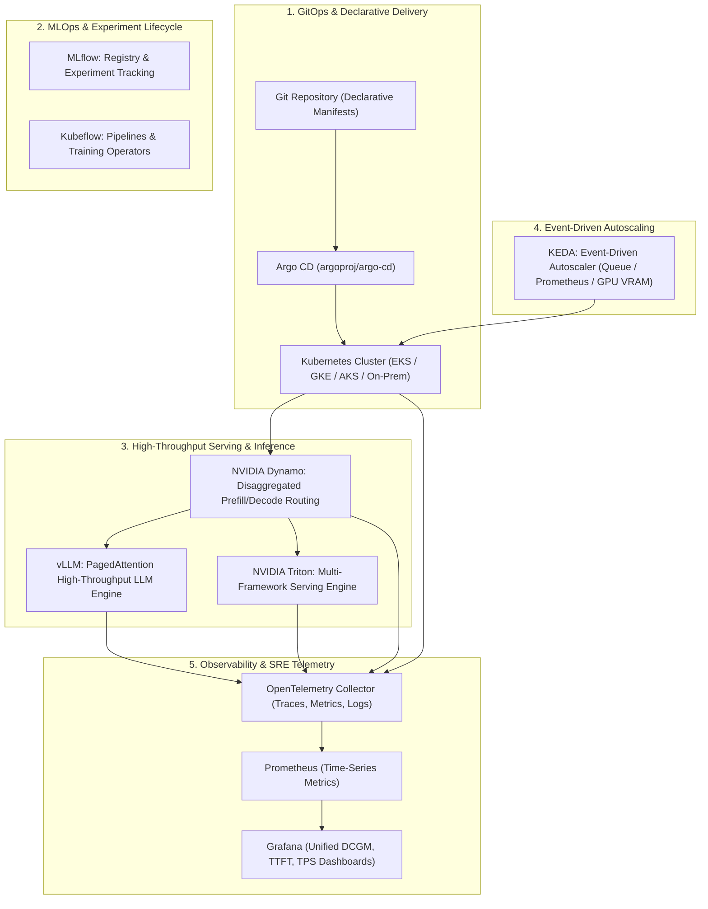

# Hi there, I'm Sanjeev Kumar 👋
### 🚀 Cloud, DevOps, DevSecOps & AI Platform Engineer | SRE Specialist

<p align="left">
  
  
  
  
  
  
  
  
  
</p>

---

## 👨‍💻 Executive Summary
Dedicated **Cloud, DevOps, and Platform Engineer** specializing in highly available multi-cloud architectures, declarative GitOps pipelines, zero-trust security postures, and next-generation AI/ML inference infrastructure (vLLM, Triton, KEDA). Proven track record designing resilient AWS infrastructures, enterprise Kubernetes deployments, automated CI/CD workflows, and autonomous AI automation pipelines.

---

## 🏛️ Modern AI & Platform Infrastructure Blueprint



---

## 📂 All Dedicated Antigravity Project Repositories (1-to-1 Mapping)

Every individual project folder developed in the **Antigravity Engineering Suite** is synchronized as its own dedicated, production-grade GitHub repository with an organized `README.md` and complete codebase:

| # | Dedicated GitHub Repository | Original Project Folder | Domain / Category | Files | Highlights & Architecture |
|:---:|:---|:---|:---|:---:|:---|
| 01 | **[TechOps-Production-Guides](https://github.com/Nova-Jaat/TechOps-Production-Guides)** | `TechOps Examples` | Cloud & DevOps Platform | 55 | 44 AWS, K8s, Docker, Terraform & SRE deep-dive engineering guides. |
| 02 | **[AI-Media-Intelligence-Analyses](https://github.com/Nova-Jaat/AI-Media-Intelligence-Analyses)** | `AI-M-Related` | Video & Media Intelligence | 101 | 100+ deep-dive video intelligence dossiers, transcripts, and growth models. |
| 03 | **[AI-Job-Hunting-Career-Playbook](https://github.com/Nova-Jaat/AI-Job-Hunting-Career-Playbook)** | `Job-Related` | Career & ATS Systems | 51 | 2026 AI Job Hunting Playbook, full-stack `aws-genai-app`, and ATS matrices. |
| 04 | **[YouTube-Tab-Batch-Processors](https://github.com/Nova-Jaat/YouTube-Tab-Batch-Processors)** | `Youtube-Tabs-Related` | Media Automation | 36 | Automated batch processors, playlist analysis, and video transcription engines. |
| 05 | **[JD-Analyzation----Remote-JOB-Related-Data-Analyzation](https://github.com/Nova-Jaat/JD-Analyzation----Remote-JOB-Related-Data-Analyzation)** | `JD. - Analyzation` | Market & JD Strategy | 22 | 11 batches analyzing 50+ remote Cloud & DevOps roles with ATS keyword mapping. |
| 06 | **[Creator-Case-Studies-Research](https://github.com/Nova-Jaat/Creator-Case-Studies-Research)** | `Course Related` | Case Studies & Growth | 21 | Creator monetization research, automation breakdowns, and system playbooks. |
| 07 | **[AI-Startup-Agency-Framework](https://github.com/Nova-Jaat/AI-Startup-Agency-Framework)** | `AI-Startup(Agency)-Related` | AI Automation Agency | 12 | Complete AAA framework: $10k roadmap, weekly operations, and launch checklists. |
| 08 | **[AI-Automation-Architect-Skills](https://github.com/Nova-Jaat/AI-Automation-Architect-Skills)** | `Technology-Related` | Agency Architecture | 11 | Antigravity custom skill (`ai-automation-architect`), SOWs, and client delivery SOPs. |
| 09 | **[Cloud-DevOps-AI-Master-Roadmap](https://github.com/Nova-Jaat/Cloud-DevOps-AI-Master-Roadmap)** | `happy-euclid` | Master Roadmaps | 4 | End-to-end Cloud, DevOps & AI Master Roadmap (`CLOUD_DEVOPS_AI_MASTER_ROADMAP.md`). |
| 10 | **[Course-Drive-Automation-Tools](https://github.com/Nova-Jaat/Course-Drive-Automation-Tools)** | `Course-Drive Related` | Cloud Automation | 4 | Automated Google Drive scraping, folder recursion, and cloud extraction utilities. |
| 11 | **[Side-Hustle-Transcript-Automation](https://github.com/Nova-Jaat/Side-Hustle-Transcript-Automation)** | `Side-Hustle-Money` | Automation Tooling | 4 | Automated YouTube transcript extractors and structured JSON processors. |
| 12 | **[Ad-Monetization-Dashboard](https://github.com/Nova-Jaat/Ad-Monetization-Dashboard)** | `Ads-Money` | Web Application | 3 | Interactive advertising revenue, RPM analytics, and frontend dashboard app. |
| 13 | **[DevOps-Senior-SRE-Interview-Prep](https://github.com/Nova-Jaat/DevOps-Senior-SRE-Interview-Prep)** | `Interview Related` | Technical Interview Prep | 3 | Senior SRE Top 20 Q&A guide, PTC Senior DevOps prep, and Zero-to-Hero compendium. |
| 14 | **[Enterprise-Process-Translation-Guide](https://github.com/Nova-Jaat/Enterprise-Process-Translation-Guide)** | `Skill-Money` | Enterprise Consulting | 3 | Enterprise business process translation guide and actionable execution strategies. |
| 15 | **[Solo-AI-Business-Blueprint](https://github.com/Nova-Jaat/Solo-AI-Business-Blueprint)** | `Tech-Money-Related` | Solo AI Business | 2 | Solo AI business blueprint and technical monetization roadmap. |
| 16 | **[Cloud-DevSecOps-Master-Notes](https://github.com/Nova-Jaat/Cloud-DevSecOps-Master-Notes)** | `DevSecOps - Related` | Cloud Security | 1 | Master DevSecOps engineering notes (Trivy, Vault, SAST/DAST, Zero-Trust). |
| 17 | **[DevOps-Master-Architecture-Blueprint](https://github.com/Nova-Jaat/DevOps-Master-Architecture-Blueprint)** | `peaceful-davinci` | Architecture Blueprints | 1 | Enterprise DevOps Master Architecture Blueprint (`DEVOPS_MASTER_BLUEPRINT.md`). |
| 18 | **[Contractor-AI-Agency-Blueprint](https://github.com/Nova-Jaat/Contractor-AI-Agency-Blueprint)** | `AI-SAAS Related` | High-Ticket AI Offers | 1 | High-ticket contractor marketing, AI service delivery, and $12k client blueprint. |
| 19 | **[Antigravity-Stitch-MCP-Guide](https://github.com/Nova-Jaat/Antigravity-Stitch-MCP-Guide)** | `Ai-Agent's-Related` | AI Agents & MCP | 1 | Antigravity Stitch MCP guide and autonomous agent integration workflows. |
| 20 | **[Digital-Product-Strategy-Notes](https://github.com/Nova-Jaat/Digital-Product-Strategy-Notes)** | `Digital.Product-Money` | Digital Products | 1 | Digital product monetization strategies, revenue funnels, and execution playbooks. |
| 21 | **[Playlist-Monetization-Research](https://github.com/Nova-Jaat/Playlist-Monetization-Research)** | `Other-Money` | Media Research | 1 | Video playlist intelligence, breakdown dossiers, and market arbitrage. |
| 22 | **[Tech-Thought-Leadership-Posts](https://github.com/Nova-Jaat/Tech-Thought-Leadership-Posts)** | `Linkedin Related Post` | Professional Branding | 1 | Technical thought-leadership articles and DevOps engineering insights. |
| 23 | **[Modern-AI-DevOps-OpenSource-Stack](https://github.com/Nova-Jaat/Modern-AI-DevOps-OpenSource-Stack)** | `GitHub Related` | Modern AI Infra Stack | 1 | Curated Top 10 Open-Source AI/DevOps platforms with Mermaid architecture diagram. |
| 24 | **[DevOps-Master-Toolkit-Reference](https://github.com/Nova-Jaat/DevOps-Master-Toolkit-Reference)** | `LinedeIn PDF Related` | Reference Toolkits | 1 | Comprehensive DevOps Master Toolkit and Cloud Reference handbook. |

---

## 🌟 Master Suites & Thematic Portfolios

| Repository | Focus & Contents | Direct Link |
|:---|:---|:---:|
| **[ChatGPT----CloudOPS-Related](https://github.com/Nova-Jaat/ChatGPT----CloudOPS-Related)** | Master suite of 9 modules consolidating 44 TechOps guides, Modern AI infra, DevSecOps, SRE prep, and Agency tools. | [Open Suite](https://github.com/Nova-Jaat/ChatGPT----CloudOPS-Related) |
| **[AI-Video-Intelligence-Research](https://github.com/Nova-Jaat/AI-Video-Intelligence-Research)** | Master video intelligence archive containing 230+ dossiers, transcripts, and batch ingestion processors. | [Open Archive](https://github.com/Nova-Jaat/AI-Video-Intelligence-Research) |
| **[Web-Monetization-Apps](https://github.com/Nova-Jaat/Web-Monetization-Apps)** | Interactive Ad Monetization Dashboard and ATS Direct Job Search Launcher applications. | [Open Web Apps](https://github.com/Nova-Jaat/Web-Monetization-Apps) |
| **[MultiCloud-DevOps-AI-Challenge](https://github.com/Nova-Jaat/MultiCloud-DevOps-AI-Challenge)** | Multi-Cloud Foundations, Kafka stream integrations, and hands-on cloud labs. | [Open Labs](https://github.com/Nova-Jaat/MultiCloud-DevOps-AI-Challenge) |
| **[Mindmap-shiv](https://github.com/Nova-Jaat/Mindmap-shiv)** | Cybersecurity, Active Directory enumeration, Burp Suite, and container security visual mindmaps. | [Open Mindmaps](https://github.com/Nova-Jaat/Mindmap-shiv) |

---

## 💻 Technical Proficiencies & Skills

```
☁️ Cloud Platforms     : AWS (VPC, IAM, Lambda, S3, CloudFront, EKS, ECS), Azure, GCP
📦 Containerization    : Docker, Kubernetes, OpenShift, Pod Disruption Budgets, CNI
⚙️ Infrastructure as Code: Terraform, Terragrunt, GitHub Actions, ArgoCD, Jenkins
📊 Observability & SRE : Prometheus, Grafana, OpenTelemetry, SLIs/SLOs, Incident Management
🛡️ Security & DevSecOps: Zero-Trust IAM, Docker Scout, Trivy, HashiCorp Vault, AWS WAF
🤖 AI & Platform Stack : vLLM, NVIDIA Triton, KEDA, Kubeflow, Agentic AI Workflows
🐍 Languages & Shell   : Python, Bash/Shell, PowerShell, JavaScript/Node.js, SQL
```

---

## 📬 Connect with Me

* **GitHub**: [@Nova-Jaat](https://github.com/Nova-Jaat)
* **Email**: [Sanjeevkumar69806@gmail.com](mailto:Sanjeevkumar69806@gmail.com)
* **Location**: India (Open to Worldwide Remote & Hybrid Roles)
